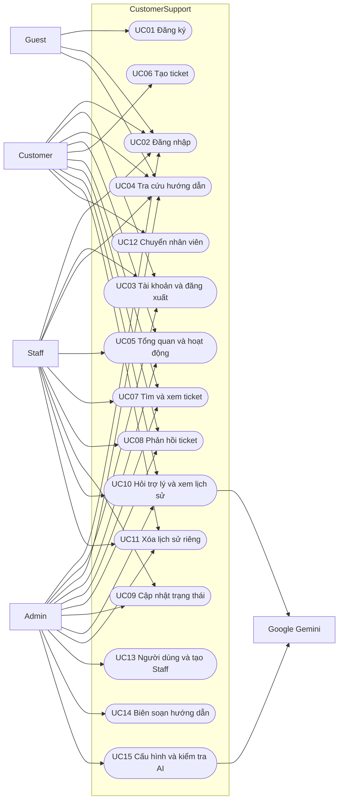

# 04. Use Case

## Actor và quyền

Customer tự đăng ký, chỉ quản lý yêu cầu của mình. Staff do Admin tạo, xử lý hàng đợi toàn bộ khách hàng. Admin xử lý như Staff và quản trị tài khoản/nội dung/AI. Guest là người chưa đăng nhập; Gemini là dịch vụ ngoài cung cấp câu trả lời, không phải tài khoản có role trong DB. Admin/Staff vẫn có chat riêng; quyền xem hàng đợi không mở quyền đọc lịch sử chat người khác.

## Danh sách theo endpoint

| ID | Use case | Actor | Endpoint |
|---|---|---|---|
| UC01 | Đăng ký Customer | Guest | Account/Register GET/POST |
| UC02 | Đăng nhập | Guest (Customer/Staff/Admin) | Account/Login GET/POST |
| UC03 | Đăng xuất, xem tài khoản, đổi mật khẩu | Customer/Staff/Admin | Account/Logout POST; Profile GET; ChangePassword GET/POST |
| UC04 | Tra cứu và đọc bài hướng dẫn | Mọi actor người dùng | Knowledge/Index, Details GET |
| UC05 | Xem tổng quan và hoạt động | Customer/Staff/Admin | Dashboard/Index, Activity GET |
| UC06 | Tạo ticket và tin nhắn đầu | Customer | Tickets/Create GET/POST |
| UC07 | Tìm/lọc/xem ticket | Customer (riêng); Staff/Admin (tất cả) | Tickets/Index, Details GET |
| UC08 | Phản hồi ticket chưa Closed | Customer (riêng); Staff/Admin | Tickets/Reply POST |
| UC09 | Cập nhật trạng thái | Staff/Admin | Tickets/UpdateStatus POST |
| UC10 | Hỏi trợ lý, xem lịch sử riêng | Customer/Staff/Admin | Assistant/Index GET, Ask POST |
| UC11 | Xóa lịch sử để bắt đầu hội thoại mới | Customer/Staff/Admin | Assistant/Clear POST |
| UC12 | Chuyển hội thoại thành ticket | Customer | Assistant/Handoff POST |
| UC13 | Xem người dùng và tạo Staff | Admin | Admin/Users GET, CreateStaff POST |
| UC14 | Tạo/sửa hướng dẫn | Admin | Knowledge/Edit GET/POST |
| UC15 | Cấu hình và kiểm tra Gemini | Admin | Settings/Index GET/POST, Test POST |

## Sơ đồ Mermaid

Mermaid flowchart biểu diễn actor và use case (không phải ký pháp UML use-case đầy đủ). Cạnh nối là quyền tham gia, không thể hiện kế thừa role: Admin không được tạo ticket thay Customer.

## Đặc tả luồng trọng tâm

**UC06 – Tạo ticket:** tiền điều kiện Customer đăng nhập; nhập Subject, Category, FirstMessage → kiểm tra ModelState và danh mục → tạo Tickets cùng TicketMessages → lưu → mở chi tiết mã CS. Dữ liệu sai trả lại form và lỗi, không tạo ticket. Staff/Admin không có quyền endpoint này.

**UC08 – Phản hồi:** người dùng được xem ticket và ticket chưa Closed → nhập Body → kiểm tra quyền và nội dung trên server → thêm tin → cập nhật UpdatedAt; phản hồi của đội hỗ trợ vào ticket Open đổi In progress. ID không thuộc quyền trả 404; Closed trả thông báo và không thêm tin.

**UC10 – Hỏi trợ lý:** đăng nhập và token CSRF hợp lệ → kiểm tra câu hỏi/rate limit → lấy tối đa 6 lượt riêng, tối đa 3 hướng dẫn phù hợp và 8 tóm tắt ticket riêng → gọi Gemini → lưu lượt → JSON và UI. Không có hướng dẫn vẫn gọi Gemini. Thiếu key/lỗi nhà cung cấp dùng fallback; câu trắng 400, vượt giới hạn 429, Gemini hạn chế nội dung vẫn báo mode ai.

**UC12 – Chuyển nhân viên:** Customer chủ động nhấn nút → lấy 3 lượt riêng → tạo ticket Other/Open với một tin nhắn chứa transcript tối đa 4000 ký tự → mở chi tiết. Không có lượt nào chuyển tới form Create; không tự gửi cho nhân viên cụ thể.

**UC15 – Cấu hình AI:** Admin nhập model/key → kiểm tra form → mã hóa và lưu ngoài wwwroot. Key trống giữ cấu hình; RemoveKey ngắt cả key môi trường. Test gọi Gemini thật và chỉ báo kết nối thành công nếu service trả Success. Có key chỉ là trạng thái cấu hình, không chứng minh kết nối hoạt động.
