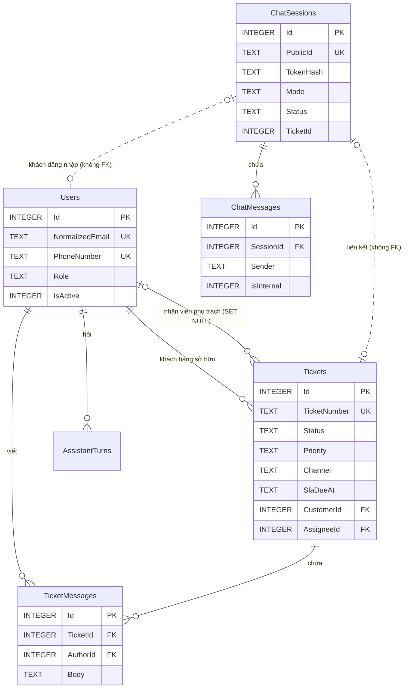

# 05. Thiết kế CSDL

Nguồn: `Models/*.cs`, `Data/AppDbContext.cs`, `Data/SupportSchema.cs`, `Data/IntegrityRules.cs`, `Data/DatabaseInitializer.cs`. SQLite, mặc định `customer-support.db` trong content root (đổi bằng `ConnectionStrings__DefaultConnection`). SQLite lưu chuỗi và DateTimeOffset dạng TEXT, bool dạng INTEGER 0/1.

## Bảng và trường

| Bảng | Cột chính | Ràng buộc |
|---|---|---|
| **Users** (tài khoản: Admin, Staff, Customer) | Id, DisplayName, Email, NormalizedEmail, PhoneNumber, PasswordHash, Role, IsActive, CreatedAt | PK Id; NormalizedEmail **UNIQUE**; PhoneNumber **UNIQUE** khi khác NULL; PasswordHash là hash PBKDF2 của ASP.NET Identity (không lưu mật khẩu rõ); Role ∈ {Admin, Staff, Customer} (trigger) |
| **Tickets** (yêu cầu hỗ trợ) | Id, TicketNumber, Subject, Category, Status, Priority, Channel, SlaDueAt, CustomerId, AssigneeId, CreatedAt, UpdatedAt | PK; TicketNumber **UNIQUE**; Status ∈ {Open, In progress, Resolved, Closed}; Priority NULL hoặc ∈ {Thấp, Trung bình, Cao, Khẩn cấp}; Channel ∈ {web, chat} (mặc định web); AssigneeId phải là Staff/Admin (trigger) |
| **TicketMessages** (lịch sử trao đổi) | Id, TicketId, AuthorId, Body, CreatedAt | Body không rỗng (trigger), ≤ 4.000 ký tự (kiểm tra ở ứng dụng) |
| **KnowledgeArticles** (kho hướng dẫn/FAQ) | Id, Title, Category, Body, UpdatedAt | Title ≤ 160, Body ≤ 6.000 (ứng dụng) |
| **AssistantTurns** (lịch sử trang Trợ lý) | Id, UserId, Question, Reply, Mode, CreatedAt | Mode: knowledge, ai, crm, crm-error |
| **AuditLogs** (nhật ký thao tác) | Id, ActorId, ActorName, Action, Target, Detail, CreatedAt | Không FK để nhật ký còn khi xóa người dùng; không chứa mật khẩu/key/nội dung chat |
| **ChatSessions** (phiên chatbot website) | Id, PublicId, TokenHash, UserId, ContactEmail, EmailVerified, VerificationSends, Mode, Status, TicketId, HandoffReason, Urgent, LastTicketMessageId, CreatedAt, UpdatedAt | PublicId **UNIQUE**; chỉ lưu SHA-256 của token phiên; Mode ∈ {bot, human}; Status ∈ {active, waiting_staff, staff_replied, closed} |
| **ChatMessages** | Id, SessionId, Sender, Body, IsInternal, AuthorId, AuthorName, TicketMessageId, CreatedAt | Sender ∈ {customer, bot, staff, system}; IsInternal = ghi chú nội bộ, không bao giờ trả về API khách |
| **AiLogs** (nhật ký vận hành AI) | Id, SessionId, Task, Provider, FallbackUsed, Success, DurationMs, RedactedCount, ToolRounds, ToolCalls, Error, CreatedAt | Không lưu câu hỏi, câu trả lời hay dữ liệu cá nhân; Task: chat, crm |

Ràng buộc giá trị (tương đương CHECK) được cài bằng trigger `trg_*` BEFORE INSERT/UPDATE vì SQLite không thêm được CHECK vào bảng đã có mà không dựng lại bảng. Trigger chỉ kiểm tra dữ liệu ghi mới, không đụng hàng cũ. Ứng dụng kiểm tra cùng quy tắc trước khi ghi; trigger là lớp chặn cuối.

## Khóa ngoại, quy tắc xóa và chỉ mục

| Quan hệ / chỉ mục | Quy tắc |
|---|---|
| Tickets.CustomerId → Users.Id | **RESTRICT** (không xóa khách hàng còn ticket qua SQL trực tiếp) |
| Tickets.AssigneeId → Users.Id | **SET NULL**: xóa nhân viên → ticket về "Chưa phân công", không mất ticket |
| TicketMessages.TicketId → Tickets.Id | CASCADE |
| TicketMessages.AuthorId → Users.Id | RESTRICT: nhân viên đã trả lời ticket của người khác không xóa được (chỉ khóa) |
| AssistantTurns.UserId → Users.Id | CASCADE |
| ChatMessages.SessionId → ChatSessions.Id | CASCADE |
| ChatSessions.UserId / TicketId | Không FK; xóa tài khoản xóa phiên liên quan trong cùng giao dịch (`UserAdministrationService.DeleteAsync`) |
| Chỉ mục | UNIQUE: Users.NormalizedEmail, Users.PhoneNumber, Tickets.TicketNumber, ChatSessions.PublicId. Thường: Tickets(CustomerId), Tickets(Status), Tickets(AssigneeId), TicketMessages(TicketId), TicketMessages(AuthorId), AssistantTurns(UserId, Id), ChatMessages(SessionId, Id), ChatSessions(TicketId), AiLogs(SessionId) |

Giao dịch: xóa tài khoản (phiên chat, tin nhắn, ticket, lịch sử trợ lý, user) chạy trong một transaction. Các thao tác khác ghi một lần `SaveChanges` (EF bọc transaction).

## ERD

KnowledgeArticles, AuditLogs và AiLogs đứng độc lập (không FK).

## Khởi tạo, nâng cấp và dữ liệu mẫu

- DB mới: `EnsureCreated` tạo toàn bộ bảng từ model, sau đó `SupportSchema` thêm trigger và 7 bài hướng dẫn mẫu.
- DB cũ: `SupportSchema` chỉ **bổ sung** (CREATE TABLE/INDEX/TRIGGER IF NOT EXISTS, ALTER TABLE ADD COLUMN cho IsActive, PhoneNumber, Priority, Channel, SlaDueAt, AssigneeId, EmailVerified, VerificationSends). Không xóa, đổi tên hay ghi đè dữ liệu; chạy nhiều lần cho kết quả như nhau. Đã kiểm thử trên DB kiểu cũ có dữ liệu (ChatbotChecks mục 20). Dự án không dùng EF migrations.
- Dữ liệu mẫu: `scripts/seed-demo.ps1` (tự backup trước) tạo 3 nhân viên, 14 khách hàng, 48 ticket có ưu tiên, SLA, người phụ trách. Tất cả tài khoản mẫu dùng `@demo.customersupport.vn`; mật khẩu sinh ngẫu nhiên ghi vào `App_Data/demo-accounts.txt` (Git bỏ qua). Chạy lại khi đã có dữ liệu mẫu chỉ điền các ô ưu tiên/người phụ trách còn trống của ticket mẫu. `-Remove` chỉ xóa dữ liệu mẫu.

API key không nằm trong DB: `App_Data/gemini-settings.json` và `chatbot-settings.json` chứa ciphertext Data Protection. Sao lưu/khôi phục: xem [12-Deployment](12-Deployment.md).
