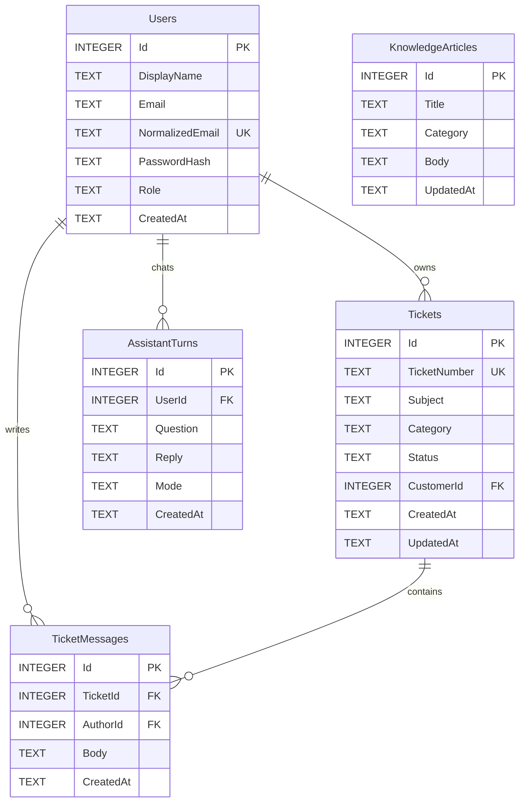

# 05. Thiết kế CSDL hiện có

Nguồn: `Models/*.cs`, `Data/AppDbContext.cs`, `SupportSchema.cs`, `DatabaseInitializer.cs`. SQLite mặc định `customer-support.db` trong content root; có thể thay bằng ConnectionStrings:DefaultConnection. Năm bảng dưới đây là bảng nghiệp vụ, không mô tả ErrorViewModel/ViewModels thành bảng. SQLite có thể có bảng kỹ thuật `sqlite_sequence` phục vụ AUTOINCREMENT.

## Từ điển dữ liệu

Tất cả thuộc tính scalar dưới đây là NOT NULL theo EF/schema hiện tại. `Id` INTEGER PK sinh tự động; `UserId`, `CustomerId`, `TicketId`, `AuthorId` là INTEGER. Chuỗi là TEXT; DateTimeOffset được provider SQLite lưu TEXT. Các giá trị mặc định UTC/role/status/mode được khởi tạo trong C#, không mặc nhiên là DEFAULT trong SQL.

| Bảng / Model | Cột (ngoài Id) | Ràng buộc và ý nghĩa |
|---|---|---|
| Users / SupportUser | DisplayName, Email, NormalizedEmail, PasswordHash, Role, CreatedAt | DisplayName ≤100; email ≤320 và EmailAddress ở model; NormalizedEmail Trim + UpperInvariant, UNIQUE; PasswordHash không lưu password rõ; Role ≤20, mặc định Customer |
| Tickets / SupportTicket | TicketNumber, Subject, Category, Status, CustomerId, CreatedAt, UpdatedAt | TicketNumber ≤24 UNIQUE (code sinh 20); Subject ≤120; Category ≤60; Status ≤20 mặc định Open; CustomerId FK Users |
| TicketMessages / TicketMessage | TicketId, AuthorId, Body, CreatedAt | TicketId FK Tickets; AuthorId FK Users; Body ≤4000 |
| KnowledgeArticles / KnowledgeArticle | Title, Category, Body, UpdatedAt | Title ≤160; Category ≤60; Body ≤6000; không có FK tác giả hoặc bảng Category |
| AssistantTurns / AssistantTurn | UserId, Question, Reply, Mode, CreatedAt | UserId FK Users; một hàng = một cặp hỏi/đáp; Mode mặc định knowledge; Question/Reply/Mode không có MaxLength ở entity; giới hạn câu hỏi ≤2000 ở request |

Required và MaxLength/StringLength là metadata/model validation của .NET; SQLite TEXT không tự kiểm tra độ dài như VARCHAR(n). Controller/view model kiểm tra input; không có SQL CHECK cho role, category hoặc status. Category ticket và category bài hướng dẫn là chuỗi độc lập, không có bảng danh mục.

## PK, FK, chỉ mục và xóa

| Liên kết / chỉ mục | Hiện thực |
|---|---|
| PK mỗi bảng | Id INTEGER, tự sinh |
| IX_Users_NormalizedEmail | UNIQUE |
| IX_Tickets_TicketNumber | UNIQUE |
| Tickets.CustomerId → Users.Id | ON DELETE RESTRICT |
| TicketMessages.TicketId → Tickets.Id | ON DELETE CASCADE |
| TicketMessages.AuthorId → Users.Id | ON DELETE RESTRICT |
| AssistantTurns.UserId → Users.Id | ON DELETE CASCADE |
| IX_AssistantTurns_UserId_Id | Composite, không UNIQUE |
| FK index do EF sinh | CustomerId, TicketId, AuthorId trên các bảng tương ứng |

Ứng dụng không có màn hình xóa user/ticket; cascade/restrict mô tả ràng buộc lưu trữ, không phải chức năng UI. Quyền riêng tư dựa trên lọc ở controller, không dựa vào DB row-level security.

## ERD Mermaid

## Khởi tạo và lưu trữ

`EnsureCreatedAsync` tạo DB mới; `SupportSchema.InitializeAsync` bổ sung KnowledgeArticles/AssistantTurns và chỉ mục bằng CREATE IF NOT EXISTS, giữ Users/Tickets/TicketMessages đã có. Seed 7 bài khi kho hoàn toàn rỗng. Không có EF migration hiện tại: EnsureCreated không tự chuyển đổi mọi schema cũ; thay đổi schema tương lai cần kế hoạch riêng và backup trước.

Key Gemini không nằm trong bảng SQL: `App_Data/gemini-settings.json` chứa ciphertext Data Protection. Không đưa DB/backup/cấu hình local vào Git. Xem 12 về backup nhất quán với WAL và phục hồi khi ứng dụng đã dừng.
