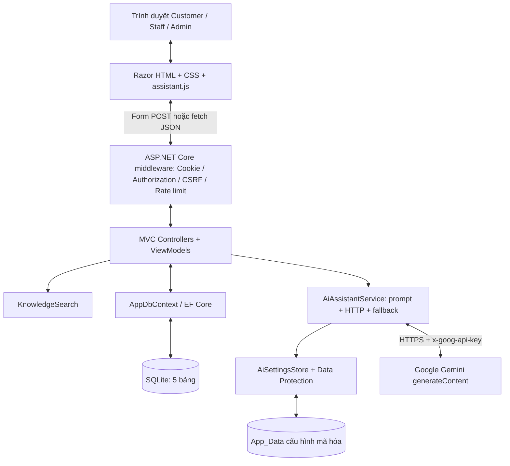

# 06. Kiến trúc hệ thống

Ứng dụng MVC một tiến trình, ưu tiên dễ hiểu và vận hành. Không có SPA riêng, microservice, vector database hay message queue.

## Thành phần

| Thành phần | Vai trò / code |
|---|---|
| Frontend | Razor `Views/` render HTML; `wwwroot/css/site.css` responsive; `assistant.js` gửi fetch JSON và render text an toàn. `site.js` hiện là placeholder, không mang nghiệp vụ |
| ASP.NET Core MVC | `Program.cs` cấu hình DI/middleware; controller kiểm tra input, authorize, đọc/ghi dữ liệu và trả View/JSON |
| Xác thực | Cookie, claims Id/Name/Email/Role; PasswordHasher; antiforgery toàn cục |
| Service | KnowledgeSearch tìm từ khóa; AiSettingsStore quản lý key mã hóa; AiAssistantService dựng prompt và gọi HTTP Gemini |
| Dữ liệu | AppDbContext/EF Core SQLite với 5 bảng; EnsureCreated và SQL bổ sung; không có repository layer riêng |
| Gemini API | HTTPS generateContent, chỉ gọi từ backend bằng header key; không có SDK Google ở frontend |
| Lưu trữ local | DB + App_Data settings; Data Protection key ring do ASP.NET quản lý dưới identity máy chạy |
| Kiểm thử/vận hành | verification console/HTTP/Edge; scripts PowerShell dùng tiện ích SQLite DatabaseChecks, không can thiệp luồng MVC |

## Architecture diagram Mermaid

## Luồng dữ liệu

**Ticket:** trình duyệt gửi form + CSRF → middleware kiểm tra phiên/quyền → controller kiểm tra dữ liệu và CustomerId → EF lưu ticket/tin → redirect tới Razor chi tiết. Staff/Admin truy cập mọi ticket; Customer chỉ của mình.

**Trợ lý:** JS POST `/Assistant/Ask` → authenticate, authorize, limiter, model validation → DB lấy lịch sử của UserId và ticket có CustomerId bằng UserId → KnowledgeSearch chọn bài → service dựng systemInstruction và contents → Gemini trả JSON hoặc lỗi → service chuyển thành reply/mode/notice → controller lưu AssistantTurns → JSON trả trình duyệt. Nguồn bài tham khảo là các bài truy xuất; hệ thống chưa xác minh tự động AI thực sự đã trích dẫn từng bài.

Middleware chạy theo thứ tự StaticFiles → RequestLocalization → Routing → Authentication → Authorization → RateLimiter → MVC endpoint. Antiforgery là filter MVC. Production có exception handler, HSTS và HTTPS redirection; Development chạy HTTP localhost.

Không gửi API key xuống trình duyệt. Hội thoại/tóm tắt ticket được gửi cho dịch vụ ngoài khi dùng Gemini; người dùng thấy thông báo riêng tư và cảnh báo AI có thể sai. Backend không có AI tool để tự sửa ticket hoặc thanh toán.
